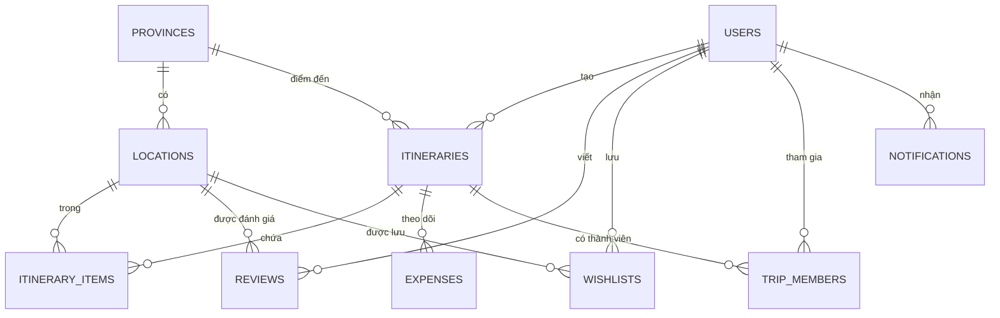

# 📋 KẾ HOẠCH PHÁT TRIỂN DỰ ÁN: ĐI CÙNG LẠC

> **Thời gian:** 6 tuần | **Nhóm:** CNPM
> **Tech Stack:** ReactJS (TS) + Tailwind | FastAPI (Python) + PostgreSQL

---

## 1️⃣ TỔNG QUAN DỰ ÁN

| Hạng mục | Nội dung |
|---|---|
| **Tên đề tài** | Đi Cùng Lạc – Nền tảng hỗ trợ lập kế hoạch & trải nghiệm du lịch |
| **Mục tiêu** | Người dùng nhập điểm đến + số ngày → Hệ thống tự tạo lịch trình chi tiết |
| **Kim chỉ nam** | Lịch trình thật – Trải nghiệm thật – Đáng tiền thật |
| **Đối tượng** | Du khách Việt Nam |
| **Nền tảng** | Website (Responsive) |

---

## 2️⃣ TECH STACK

| Layer | Công nghệ | Vai trò |
|---|---|---|
| Frontend | ReactJS (TypeScript) | Giao diện người dùng |
| CSS | Tailwind CSS | Styling |
| Backend | Python (FastAPI) | API Server |
| Database | PostgreSQL | Lưu trữ dữ liệu |
| Auth | JWT (python-jose) | Xác thực người dùng |
| Map | Leaflet.js | Hiển thị bản đồ |
| Weather API | OpenWeatherMap | Dự báo thời tiết |
| PDF | ReportLab / WeasyPrint | Xuất lịch trình PDF |

---

## 3️⃣ DANH SÁCH 18 CHỨC NĂNG

### 🥇 CORE (Phase 1-2) — Bắt buộc

| # | Chức năng | Mô tả | Backend | Frontend |
|---|---|---|---|---|
| 1 | 🔐 Đăng ký / Đăng nhập | Email + password, JWT token | Auth API | Form login/register |
| 2 | 📍 Khám phá địa điểm | Xem, lọc, tìm theo tỉnh | CRUD API | Trang explore + cards |
| 3 | 🧠 Tạo lịch trình tự động | Nhập điểm đến + số ngày → sinh lịch trình | Thuật toán Planner | Form + hiển thị |
| 4 | ✏️ Chỉnh sửa lịch trình | Xóa/thêm/đổi thứ tự | Update API | Drag & drop UI |
| 5 | 💾 Lưu & Quản lý | Lưu, xem lại, xóa lịch trình | CRUD API | Trang my-trips |
| 6 | 💰 Tính toán chi phí | Tổng hợp chi phí theo hạng mục | Cost API | Bảng chi phí |

### 🥈 NÂNG CAO (Phase 3) — Ghi điểm

| # | Chức năng | Mô tả | Backend | Frontend |
|---|---|---|---|---|
| 7 | ⭐ Đánh giá & Review | Chấm sao + bình luận + ảnh | Review API | Form + list review |
| 8 | ❤️ Wishlist | Lưu địa điểm yêu thích | Wishlist API | Nút ❤️ + trang wishlist |
| 9 | 🔗 Chia sẻ lịch trình | Tạo link công khai | Share API | Nút chia sẻ + trang public |
| 10 | 🔧 Trang Admin | Quản lý user, địa điểm, review | Admin API | Dashboard admin |

### 🆕 BỔ SUNG (Phase 4) — Ấn tượng

| # | Chức năng | Mô tả | Backend | Frontend |
|---|---|---|---|---|
| 11 | 📄 Xuất PDF | Tải lịch trình dạng PDF | PDF generation | Nút tải PDF |
| 12 | 🌤️ Thời tiết | Dự báo thời tiết theo ngày | Weather API proxy | Hiển thị trên lịch trình |
| 13 | 📊 So sánh ngân sách | Dự kiến vs thực tế | Expense API | Bảng so sánh |
| 14 | 🎉 Gợi ý theo mùa | Gợi ý điểm đến theo tháng | Seasonal API | Section trên trang chủ |

### 🚀 MỞ RỘNG (Phase 5) — Nếu còn thời gian

| # | Chức năng | Mô tả | Backend | Frontend |
|---|---|---|---|---|
| 15 | 👥 Lịch trình nhóm | Mời bạn bè + vote | Group API | Mời + vote UI |
| 16 | 📝 Ghi chú | Note cho từng địa điểm | Notes API | Inline editing |
| 17 | 👤 Hồ sơ & Thống kê | Profile + stats cá nhân | Stats API | Trang profile |
| 18 | 🔔 Thông báo | Nhắc nhở chuyến đi | Notification API | Bell icon + dropdown |

---

## 4️⃣ TIMELINE – GANTT CHART

```mermaid
flowchart LR
    subgraph W1["📦 TUẦN 1"]
        T1["Setup project"]
        T2["Database + Models"]
        T3["Auth API + UI"]
        T4["Seed data"]
    end

    subgraph W2["🧠 TUẦN 2"]
        T5["API Provinces + Locations"]
        T6["Thuật toán Planner"]
        T7["UI Khám phá"]
        T8["UI Tạo lịch trình"]
    end

    subgraph W3["✏️ TUẦN 3"]
        T9["Chỉnh sửa lịch trình"]
        T10["Lưu & Quản lý"]
        T11["Tính toán chi phí"]
        T12["UI hoàn thiện Core"]
    end

    subgraph W4["⭐ TUẦN 4"]
        T13["Review + Wishlist"]
        T14["Chia sẻ lịch trình"]
        T15["Trang Admin"]
        T16["UI nâng cao"]
    end

    subgraph W5["📄 TUẦN 5"]
        T17["Xuất PDF"]
        T18["Thời tiết"]
        T19["Ngân sách thực tế"]
        T20["Gợi ý theo mùa"]
    end

    subgraph W6["🚀 TUẦN 6"]
        T21["Nhóm + Ghi chú"]
        T22["Profile + Thông báo"]
        T23["Testing & Bug fix"]
        T24["Deploy + Báo cáo"]
    end

    W1 --> W2 --> W3 --> W4 --> W5 --> W6
```



---

## 5️⃣ CHI TIẾT TỪNG TUẦN

### 📦 TUẦN 1 – Setup & Nền tảng (Phase 1)

| Task | Mô tả | Output |
|---|---|---|
| 1.1 | Khởi tạo project Backend (FastAPI) | Cấu trúc thư mục, requirements.txt, .env |
| 1.2 | Khởi tạo project Frontend (React + TS + Tailwind) | package.json, vite config, tailwind config |
| 1.3 | Thiết kế & tạo Database (PostgreSQL) | 10 bảng theo ERD |
| 1.4 | Tạo SQLAlchemy Models | models/ (10 files) |
| 1.5 | Tạo Pydantic Schemas | schemas/ (4 files) |
| 1.6 | API Đăng ký + Đăng nhập (JWT) | POST /auth/register, /auth/login |
| 1.7 | UI Đăng nhập + Đăng ký | Trang login, register |
| 1.8 | Navbar + Layout chung | Component Navbar, Footer |
| 1.9 | Seed data (Vũng Tàu ~25 địa điểm, Đà Lạt ~15) | Script seed_data.py |

**✅ Kết quả cuối tuần 1:** Đăng ký/đăng nhập hoạt động, database có dữ liệu mẫu

---

### 🧠 TUẦN 2 – Core chính (Phase 2a)

| Task | Mô tả | Output |
|---|---|---|
| 2.1 | API danh sách tỉnh/thành | GET /provinces |
| 2.2 | API địa điểm theo tỉnh + lọc | GET /provinces/{id}/locations |
| 2.3 | API chi tiết địa điểm | GET /locations/{id} |
| 2.4 | API tìm kiếm địa điểm | GET /locations/search |
| 2.5 | **🧠 Thuật toán Planner** | POST /itineraries/generate |
| 2.6 | API tính chi phí | GET /itineraries/{id}/costs |
| 2.7 | Trang chủ (Hero + Form tạo trip) | Trang Home.tsx |
| 2.8 | Trang khám phá (list + filter) | Trang Explore.tsx |
| 2.9 | Component Card địa điểm | LocationCard.tsx |
| 2.10 | Trang tạo lịch trình (form) | PlanTrip.tsx |
| 2.11 | Component Timeline lịch trình | ItineraryTimeline.tsx |
| 2.12 | Component bảng chi phí | CostSummary.tsx |

**✅ Kết quả cuối tuần 2:** Tạo lịch trình tự động hoạt động end-to-end

---

### ✏️ TUẦN 3 – Hoàn thiện Core (Phase 2b)

| Task | Mô tả | Output |
|---|---|---|
| 3.1 | API lưu lịch trình | POST /itineraries |
| 3.2 | API danh sách lịch trình của tôi | GET /itineraries/my |
| 3.3 | API cập nhật lịch trình | PUT /itineraries/{id} |
| 3.4 | API thêm/xóa item trong lịch trình | POST/DELETE items |
| 3.5 | API xóa lịch trình | DELETE /itineraries/{id} |
| 3.6 | API đổi trạng thái | PATCH /itineraries/{id}/status |
| 3.7 | Trang chi tiết lịch trình | ViewItinerary.tsx |
| 3.8 | UI chỉnh sửa lịch trình | Drag & drop, thêm/xóa |
| 3.9 | Trang "Chuyến đi của tôi" | MyTrips.tsx |
| 3.10 | Trang chi tiết địa điểm | LocationDetail.tsx |
| 3.11 | Responsive toàn bộ | Mobile-first |

**✅ Kết quả cuối tuần 3:** 6 chức năng Core hoàn chỉnh

---

### ⭐ TUẦN 4 – Nâng cao (Phase 3)

| Task | Mô tả | Output |
|---|---|---|
| 4.1 | API tạo/xem review | POST/GET reviews |
| 4.2 | API wishlist (thêm/xóa/xem) | CRUD wishlist |
| 4.3 | API chia sẻ (tạo link + xem) | POST share, GET shared |
| 4.4 | API Admin (dashboard, CRUD) | Admin endpoints |
| 4.5 | UI đánh giá (form + stars) | Review components |
| 4.6 | UI wishlist (nút ❤️ + trang) | Wishlist page |
| 4.7 | UI chia sẻ (nút + trang public) | Share feature |
| 4.8 | UI Admin dashboard | Admin pages (4 trang) |

**✅ Kết quả cuối tuần 4:** 10 chức năng hoạt động

---

### 📄 TUẦN 5 – Bổ sung (Phase 4)

| Task | Mô tả | Output |
|---|---|---|
| 5.1 | Xuất PDF lịch trình | PDF generation + download |
| 5.2 | Tích hợp API thời tiết | OpenWeatherMap proxy |
| 5.3 | API chi tiêu thực tế + so sánh | Expense tracking |
| 5.4 | API gợi ý theo mùa/lễ hội | Seasonal suggestions |
| 5.5 | UI thời tiết trên lịch trình | Weather badges |
| 5.6 | UI so sánh ngân sách | Comparison table |
| 5.7 | UI gợi ý mùa trên trang chủ | Seasonal section |

**✅ Kết quả cuối tuần 5:** 14 chức năng hoạt động

---

### 🚀 TUẦN 6 – Mở rộng + Hoàn tất (Phase 5)

| Task | Mô tả | Output |
|---|---|---|
| 6.1 | API lịch trình nhóm (mời + vote) | Group trip endpoints |
| 6.2 | API ghi chú chuyến đi | Notes CRUD |
| 6.3 | API hồ sơ + thống kê | Profile + stats |
| 6.4 | API thông báo | Notifications |
| 6.5 | UI các tính năng mở rộng | 4 trang/component mới |
| 6.6 | Testing toàn bộ hệ thống | Test cases |
| 6.7 | Fix bugs | Bug fixes |
| 6.8 | Viết tài liệu báo cáo | Word/PDF báo cáo |
| 6.9 | Deploy (nếu có) | Vercel + Railway |

**✅ Kết quả cuối tuần 6:** 18 chức năng, sẵn sàng nộp

---

## 6️⃣ CẤU TRÚC THƯ MỤC

```
CNPM/
├── backend/
│   ├── app/
│   │   ├── main.py
│   │   ├── config.py
│   │   ├── database.py
│   │   ├── models/
│   │   │   ├── user.py
│   │   │   ├── province.py
│   │   │   ├── location.py
│   │   │   ├── itinerary.py
│   │   │   ├── review.py
│   │   │   ├── wishlist.py
│   │   │   ├── expense.py
│   │   │   ├── trip_member.py
│   │   │   └── notification.py
│   │   ├── schemas/
│   │   │   ├── auth.py
│   │   │   ├── province.py
│   │   │   ├── location.py
│   │   │   └── itinerary.py
│   │   ├── routers/
│   │   │   ├── auth.py
│   │   │   ├── provinces.py
│   │   │   ├── locations.py
│   │   │   ├── itineraries.py
│   │   │   ├── reviews.py
│   │   │   ├── wishlists.py
│   │   │   ├── admin.py
│   │   │   └── shared.py
│   │   ├── services/
│   │   │   ├── auth.py
│   │   │   └── planner.py
│   │   └── seed/
│   │       └── seed_data.py
│   ├── requirements.txt
│   └── .env
│
├── frontend/
│   ├── src/
│   │   ├── main.tsx
│   │   ├── App.tsx
│   │   ├── index.css
│   │   ├── types/
│   │   │   └── index.ts
│   │   ├── services/
│   │   │   └── api.ts
│   │   ├── contexts/
│   │   │   └── AuthContext.tsx
│   │   ├── components/
│   │   │   ├── Navbar.tsx
│   │   │   ├── ProvinceCard.tsx
│   │   │   ├── LocationCard.tsx
│   │   │   ├── ItineraryTimeline.tsx
│   │   │   └── CostSummary.tsx
│   │   └── pages/
│   │       ├── Home.tsx
│   │       ├── Explore.tsx
│   │       ├── LocationDetail.tsx
│   │       ├── PlanTrip.tsx
│   │       ├── ViewItinerary.tsx
│   │       ├── MyTrips.tsx
│   │       ├── Login.tsx
│   │       ├── Register.tsx
│   │       └── Admin.tsx
│   ├── package.json
│   ├── vite.config.ts
│   ├── tailwind.config.js
│   └── tsconfig.json
│
├── ytuong.docx
└── README.md
```

---

## 7️⃣ DATABASE – 10 BẢNG



| # | Bảng | Số cột | Mô tả |
|---|---|---|---|
| 1 | users | 7 | Người dùng |
| 2 | provinces | 8 | Tỉnh/Thành phố |
| 3 | locations | 15 | Địa điểm |
| 4 | itineraries | 10 | Lịch trình |
| 5 | itinerary_items | 7 | Chi tiết lịch trình |
| 6 | reviews | 7 | Đánh giá |
| 7 | wishlists | 4 | Yêu thích |
| 8 | expenses | 5 | Chi tiêu |
| 9 | trip_members | 5 | Thành viên nhóm |
| 10 | notifications | 6 | Thông báo |

---

## 8️⃣ DANH SÁCH API (40+ endpoints)

### Auth (3)
| Method | Endpoint | Phase |
|---|---|---|
| POST | `/api/auth/register` | 1 |
| POST | `/api/auth/login` | 1 |
| GET | `/api/auth/me` | 1 |

### Provinces (3)
| Method | Endpoint | Phase |
|---|---|---|
| GET | `/api/provinces` | 2 |
| GET | `/api/provinces/{id}` | 2 |
| GET | `/api/provinces/{id}/locations` | 2 |

### Locations (2)
| Method | Endpoint | Phase |
|---|---|---|
| GET | `/api/locations/{id}` | 2 |
| GET | `/api/locations/search` | 2 |

### Itineraries (9)
| Method | Endpoint | Phase |
|---|---|---|
| POST | `/api/itineraries/generate` | 2 |
| POST | `/api/itineraries` | 3 |
| GET | `/api/itineraries/my` | 3 |
| GET | `/api/itineraries/{id}` | 3 |
| PUT | `/api/itineraries/{id}` | 3 |
| DELETE | `/api/itineraries/{id}` | 3 |
| POST | `/api/itineraries/{id}/items` | 3 |
| DELETE | `/api/itineraries/{id}/items/{item_id}` | 3 |
| GET | `/api/itineraries/{id}/costs` | 2 |

### Reviews (3)
| Method | Endpoint | Phase |
|---|---|---|
| POST | `/api/locations/{id}/reviews` | 4 |
| GET | `/api/locations/{id}/reviews` | 4 |
| DELETE | `/api/reviews/{id}` | 4 |

### Wishlist (3)
| Method | Endpoint | Phase |
|---|---|---|
| POST | `/api/wishlist/{location_id}` | 4 |
| DELETE | `/api/wishlist/{location_id}` | 4 |
| GET | `/api/wishlist` | 4 |

### Share (3)
| Method | Endpoint | Phase |
|---|---|---|
| POST | `/api/itineraries/{id}/share` | 4 |
| GET | `/api/shared/{share_code}` | 4 |
| POST | `/api/shared/{share_code}/clone` | 4 |

### Admin (7)
| Method | Endpoint | Phase |
|---|---|---|
| GET | `/api/admin/dashboard` | 4 |
| GET | `/api/admin/users` | 4 |
| PATCH | `/api/admin/users/{id}` | 4 |
| POST | `/api/admin/locations` | 4 |
| PUT | `/api/admin/locations/{id}` | 4 |
| DELETE | `/api/admin/locations/{id}` | 4 |
| DELETE | `/api/admin/reviews/{id}` | 4 |

### Bổ sung (4)
| Method | Endpoint | Phase |
|---|---|---|
| GET | `/api/itineraries/{id}/export-pdf` | 5 |
| GET | `/api/weather` | 5 |
| POST | `/api/itineraries/{id}/expenses` | 5 |
| GET | `/api/suggestions/seasonal` | 5 |

### Mở rộng (8)
| Method | Endpoint | Phase |
|---|---|---|
| POST | `/api/itineraries/{id}/invite` | 6 |
| POST | `/api/itineraries/join/{code}` | 6 |
| GET | `/api/itineraries/{id}/members` | 6 |
| POST | `/api/itinerary-items/{id}/notes` | 6 |
| GET | `/api/users/me/profile` | 6 |
| PUT | `/api/users/me/profile` | 6 |
| GET | `/api/users/me/stats` | 6 |
| GET | `/api/notifications` | 6 |

---

## 9️⃣ TỔNG KẾT

| Hạng mục | Số lượng |
|---|---|
| Chức năng | **18** |
| Bảng database | **10** |
| API endpoints | **45+** |
| Trang giao diện | **16** |
| Components | **10+** |
| Thời gian | **6 tuần** |
| Phases | **5** |

---

> [!IMPORTANT]
> Nhấn **Proceed** khi bạn đồng ý bảng kế hoạch này để tôi bắt đầu triển khai code theo đúng thứ tự Phase 1 → Phase 5.
