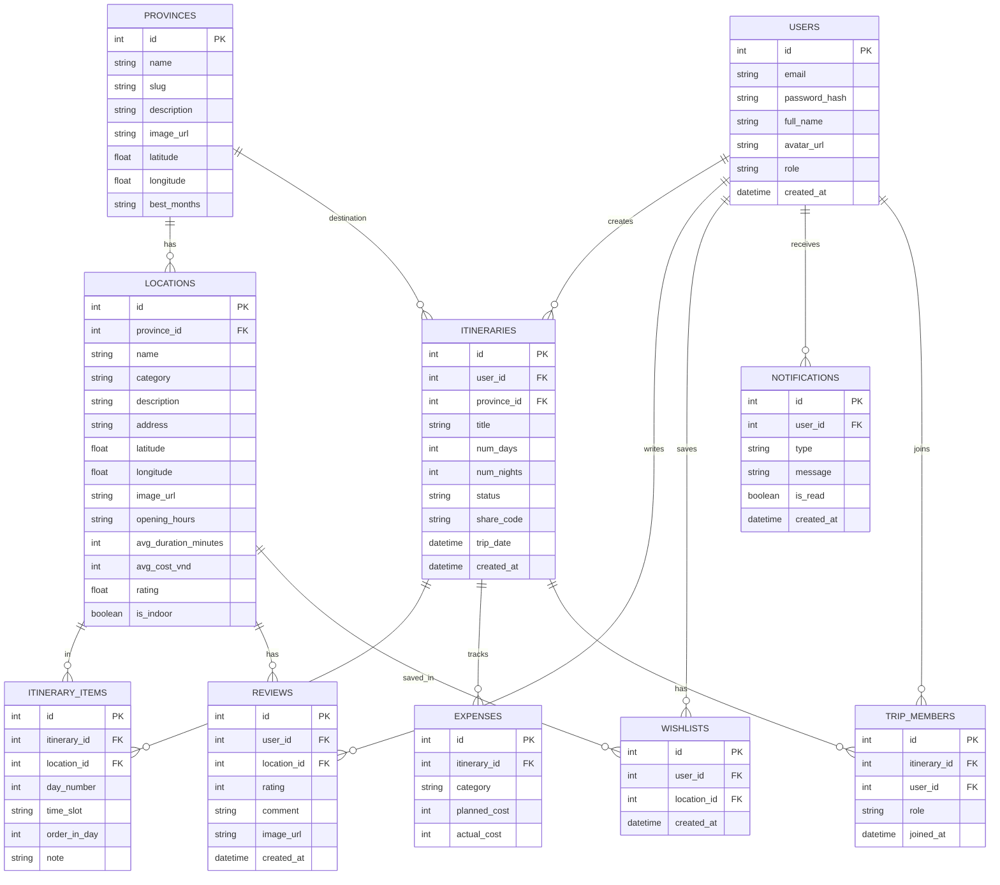
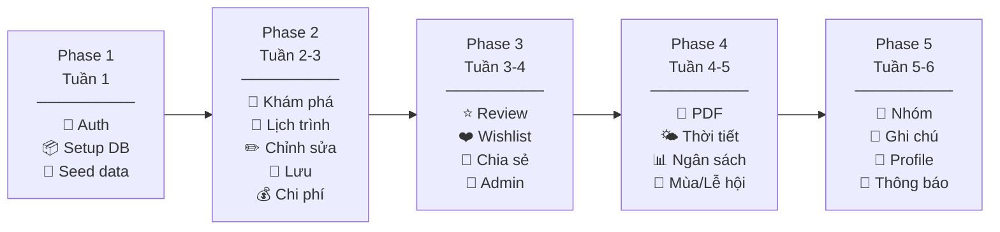

# 🧭 ĐI CÙNG LẠC – TỔNG HỢP 18 CHỨC NĂNG

> **Tech Stack:** ReactJS (TypeScript) + Tailwind CSS | FastAPI (Python) + PostgreSQL
>
> **Kim chỉ nam:** *Lịch trình thật – Trải nghiệm thật – Đáng tiền thật*

---

## 📊 BẢNG TỔNG HỢP

| # | Chức năng | Nhóm | Phase |
|---|---|---|---|
| 1 | 🔐 Đăng ký / Đăng nhập | 🥇 Core | 1 |
| 2 | 📍 Khám phá địa điểm | 🥇 Core | 2 |
| 3 | 🧠 Tạo lịch trình tự động | 🥇 Core | 2 |
| 4 | ✏️ Chỉnh sửa lịch trình | 🥇 Core | 2 |
| 5 | 💾 Lưu & Quản lý lịch trình | 🥇 Core | 2 |
| 6 | 💰 Tính toán chi phí | 🥇 Core | 2 |
| 7 | ⭐ Đánh giá & Review | 🥈 Nâng cao | 3 |
| 8 | ❤️ Wishlist (Yêu thích) | 🥈 Nâng cao | 3 |
| 9 | 🔗 Chia sẻ lịch trình | 🥈 Nâng cao | 3 |
| 10 | 🔧 Trang Admin | 🥈 Nâng cao | 3 |
| 11 | 📄 Xuất PDF lịch trình | 🆕 Bổ sung | 4 |
| 12 | 🌤️ Thời tiết theo ngày | 🆕 Bổ sung | 4 |
| 13 | 📊 So sánh ngân sách thực tế | 🆕 Bổ sung | 4 |
| 14 | 🎉 Gợi ý theo mùa / lễ hội | 🆕 Bổ sung | 4 |
| 15 | 👥 Lịch trình nhóm | 🚀 Mở rộng | 5 |
| 16 | 📝 Ghi chú chuyến đi | 🚀 Mở rộng | 5 |
| 17 | 👤 Hồ sơ & Thống kê cá nhân | 🚀 Mở rộng | 5 |
| 18 | 🔔 Thông báo nhắc nhở | 🚀 Mở rộng | 5 |

---

## 🥇 CORE – 6 chức năng (bắt buộc)

### 1. 🔐 Đăng ký / Đăng nhập
- Đăng ký bằng email + password
- Đăng nhập → nhận JWT token
- Phân quyền: **User** / **Admin**
- API:

| Method | Endpoint | Mô tả |
|---|---|---|
| POST | `/api/auth/register` | Đăng ký |
| POST | `/api/auth/login` | Đăng nhập |
| GET | `/api/auth/me` | Thông tin user hiện tại |

---

### 2. 📍 Khám phá địa điểm
- Xem danh sách tỉnh/thành phố
- Xem danh sách địa điểm theo tỉnh
- Lọc theo loại: tham quan / ăn uống / cà phê / khách sạn
- Lọc theo giá, đánh giá
- Xem chi tiết: ảnh, mô tả, giờ mở cửa, giá, vị trí
- API:

| Method | Endpoint | Mô tả |
|---|---|---|
| GET | `/api/provinces` | Danh sách tỉnh/thành |
| GET | `/api/provinces/{id}` | Chi tiết tỉnh |
| GET | `/api/provinces/{id}/locations` | Địa điểm theo tỉnh |
| GET | `/api/locations/{id}` | Chi tiết địa điểm |
| GET | `/api/locations/search?q=&category=&min_rating=` | Tìm kiếm + lọc |

---

### 3. 🧠 Tạo lịch trình tự động
- Nhập: điểm đến + số ngày + số đêm
- Hệ thống tự phân bổ địa điểm theo ngày
- Sắp xếp theo khoảng cách gần nhau
- Xen kẽ: tham quan → ăn trưa → tham quan → cà phê → ăn tối
- API:

| Method | Endpoint | Mô tả |
|---|---|---|
| POST | `/api/itineraries/generate` | 🧠 Tạo lịch trình tự động |

```json
// Request
{
  "province_id": 1,
  "num_days": 3,
  "num_nights": 2
}

// Response
{
  "itinerary": {
    "destination": "Vũng Tàu",
    "days": [
      {
        "day_number": 1,
        "title": "Khám phá trung tâm",
        "items": [
          { "time": "08:00", "location": "Bãi Trước", "duration": "2h", "cost": 0 },
          { "time": "11:30", "location": "Bánh khọt Gốc Vú Sữa", "duration": "45p", "cost": 50000 }
        ]
      }
    ],
    "total_cost": 1450000
  }
}
```

---

### 4. ✏️ Chỉnh sửa lịch trình
- Xóa địa điểm không thích
- Thêm địa điểm mới từ danh sách
- Kéo thả đổi thứ tự
- Chuyển địa điểm sang ngày khác
- API:

| Method | Endpoint | Mô tả |
|---|---|---|
| PUT | `/api/itineraries/{id}` | Cập nhật lịch trình |
| POST | `/api/itineraries/{id}/items` | Thêm địa điểm |
| DELETE | `/api/itineraries/{id}/items/{item_id}` | Xóa địa điểm |
| PUT | `/api/itineraries/{id}/items/{item_id}` | Đổi thứ tự/ngày |

---

### 5. 💾 Lưu & Quản lý lịch trình
- Lưu lịch trình đã tạo/chỉnh sửa
- Xem danh sách lịch trình của tôi
- Trạng thái: **Sắp đi** / **Đang đi** / **Đã hoàn thành**
- Xóa lịch trình
- API:

| Method | Endpoint | Mô tả |
|---|---|---|
| POST | `/api/itineraries` | Lưu lịch trình |
| GET | `/api/itineraries/my` | Danh sách của tôi |
| GET | `/api/itineraries/{id}` | Chi tiết lịch trình |
| DELETE | `/api/itineraries/{id}` | Xóa lịch trình |
| PATCH | `/api/itineraries/{id}/status` | Đổi trạng thái |

---

### 6. 💰 Tính toán chi phí
- Tự động tổng hợp chi phí từ các địa điểm trong lịch trình
- Phân loại: ăn uống / vé / di chuyển / cà phê
- Hiển thị: tổng, theo ngày, theo hạng mục
- Cập nhật khi chỉnh sửa lịch trình
- API:

| Method | Endpoint | Mô tả |
|---|---|---|
| GET | `/api/itineraries/{id}/costs` | Chi phí dự kiến |

---

## 🥈 NÂNG CAO – 4 chức năng

### 7. ⭐ Đánh giá & Review
- Chấm sao 1-5 cho địa điểm
- Viết bình luận
- Upload ảnh kèm review
- Xem danh sách review theo địa điểm
- Điểm trung bình + tổng lượt đánh giá
- API:

| Method | Endpoint | Mô tả |
|---|---|---|
| POST | `/api/locations/{id}/reviews` | Tạo review |
| GET | `/api/locations/{id}/reviews` | Danh sách review |
| DELETE | `/api/reviews/{id}` | Xóa review (chủ/admin) |

---

### 8. ❤️ Wishlist (Yêu thích)
- Nhấn ❤️ để lưu địa điểm yêu thích
- Xem danh sách yêu thích
- Chọn từ wishlist khi tạo/chỉnh sửa lịch trình
- Bỏ yêu thích
- API:

| Method | Endpoint | Mô tả |
|---|---|---|
| POST | `/api/wishlist/{location_id}` | Thêm yêu thích |
| DELETE | `/api/wishlist/{location_id}` | Bỏ yêu thích |
| GET | `/api/wishlist` | Danh sách yêu thích |

---

### 9. 🔗 Chia sẻ lịch trình
- Tạo link công khai cho lịch trình
- Người nhận xem được (không cần đăng nhập)
- Người nhận có thể copy lịch trình về tài khoản mình
- API:

| Method | Endpoint | Mô tả |
|---|---|---|
| POST | `/api/itineraries/{id}/share` | Tạo link chia sẻ |
| GET | `/api/shared/{share_code}` | Xem lịch trình chia sẻ |
| POST | `/api/shared/{share_code}/clone` | Copy về tài khoản |

---

### 10. 🔧 Trang Admin
- Dashboard thống kê: tổng user, địa điểm, lịch trình, review
- CRUD địa điểm (thêm/sửa/xóa)
- Quản lý người dùng (xem/khóa)
- Duyệt/xóa review vi phạm
- API:

| Method | Endpoint | Mô tả |
|---|---|---|
| GET | `/api/admin/dashboard` | Thống kê tổng quan |
| GET | `/api/admin/users` | Danh sách user |
| PATCH | `/api/admin/users/{id}` | Khóa/mở user |
| POST | `/api/admin/locations` | Thêm địa điểm |
| PUT | `/api/admin/locations/{id}` | Sửa địa điểm |
| DELETE | `/api/admin/locations/{id}` | Xóa địa điểm |
| DELETE | `/api/admin/reviews/{id}` | Xóa review vi phạm |

---

## 🆕 BỔ SUNG – 4 chức năng

### 11. 📄 Xuất PDF lịch trình
- Xuất lịch trình thành file PDF đẹp
- Bao gồm: lịch trình theo ngày, địa chỉ, chi phí
- Dùng khi không có mạng
- API:

| Method | Endpoint | Mô tả |
|---|---|---|
| GET | `/api/itineraries/{id}/export-pdf` | Tải file PDF |

---

### 12. 🌤️ Thời tiết theo ngày
- Hiển thị dự báo thời tiết tại điểm đến
- Theo ngày du lịch đã chọn
- Gợi ý: ngày mưa → indoor, ngày nắng → outdoor
- API:

| Method | Endpoint | Mô tả |
|---|---|---|
| GET | `/api/weather?province_id=&date=` | Dự báo thời tiết |

---

### 13. 📊 So sánh ngân sách thực tế
- Sau chuyến đi: nhập chi tiêu thực tế
- So sánh: dự kiến vs thực tế theo hạng mục
- Hiển thị chênh lệch + gợi ý
- API:

| Method | Endpoint | Mô tả |
|---|---|---|
| POST | `/api/itineraries/{id}/expenses` | Nhập chi tiêu thực tế |
| GET | `/api/itineraries/{id}/budget-compare` | So sánh ngân sách |

---

### 14. 🎉 Gợi ý theo mùa / lễ hội
- Gợi ý điểm đến phù hợp theo tháng hiện tại
- Hiển thị lễ hội, sự kiện đặc biệt
- Hiện trên trang chủ
- API:

| Method | Endpoint | Mô tả |
|---|---|---|
| GET | `/api/suggestions/seasonal?month=` | Gợi ý theo mùa |

---

## 🚀 MỞ RỘNG – 4 chức năng

### 15. 👥 Lịch trình nhóm
- Mời bạn bè tham gia lịch trình qua link
- Thành viên cùng xem & vote địa điểm
- Chủ trip quyết định cuối cùng
- API:

| Method | Endpoint | Mô tả |
|---|---|---|
| POST | `/api/itineraries/{id}/invite` | Tạo link mời |
| POST | `/api/itineraries/join/{invite_code}` | Tham gia nhóm |
| GET | `/api/itineraries/{id}/members` | Danh sách thành viên |
| POST | `/api/itineraries/{id}/vote` | Vote địa điểm |

---

### 16. 📝 Ghi chú chuyến đi
- Thêm ghi chú cho từng địa điểm trong lịch trình
- Thêm ghi chú chung cho từng ngày
- Ví dụ: "Nhớ đặt bàn trước", "Mang kem chống nắng"
- API:

| Method | Endpoint | Mô tả |
|---|---|---|
| POST | `/api/itinerary-items/{id}/notes` | Thêm ghi chú |
| PUT | `/api/notes/{id}` | Sửa ghi chú |
| DELETE | `/api/notes/{id}` | Xóa ghi chú |

---

### 17. 👤 Hồ sơ & Thống kê cá nhân
- Trang profile: ảnh, tên, email
- Thống kê: số tỉnh đã đi, lịch trình đã tạo, review đã viết
- Huy hiệu thành tựu
- API:

| Method | Endpoint | Mô tả |
|---|---|---|
| GET | `/api/users/me/profile` | Thông tin profile |
| PUT | `/api/users/me/profile` | Cập nhật profile |
| GET | `/api/users/me/stats` | Thống kê cá nhân |

---

### 18. 🔔 Thông báo nhắc nhở
- Nhắc 1 ngày trước chuyến đi
- Nhắc lịch trình sáng mỗi ngày trong trip
- Thông báo khi được mời vào lịch trình nhóm
- API:

| Method | Endpoint | Mô tả |
|---|---|---|
| GET | `/api/notifications` | Danh sách thông báo |
| PATCH | `/api/notifications/{id}/read` | Đánh dấu đã đọc |

---

## 🗄️ DATABASE – ERD đầy đủ



---

## 📅 PHÂN PHASE



---

## 🖥️ CÁC TRANG GIAO DIỆN

| Trang | URL | Chức năng liên quan |
|---|---|---|
| Trang chủ | `/` | Tìm kiếm, gợi ý mùa, điểm đến phổ biến |
| Đăng ký | `/register` | #1 |
| Đăng nhập | `/login` | #1 |
| Khám phá | `/explore/{province}` | #2 |
| Chi tiết địa điểm | `/location/{id}` | #2, #7, #8 |
| Tạo lịch trình | `/plan` | #3 |
| Xem lịch trình | `/itinerary/{id}` | #3, #4, #6, #9, #11, #16 |
| Lịch trình của tôi | `/my-trips` | #5, #13 |
| Yêu thích | `/wishlist` | #8 |
| Hồ sơ cá nhân | `/profile` | #17 |
| Thông báo | `/notifications` | #18 |
| Admin Dashboard | `/admin` | #10 |
| Admin Địa điểm | `/admin/locations` | #10 |
| Admin Users | `/admin/users` | #10 |
| Admin Reviews | `/admin/reviews` | #10 |
| Lịch trình chia sẻ | `/s/{share_code}` | #9 |

---

> [!IMPORTANT]
> Đây là bản **CHỐT CUỐI CÙNG** với **18 chức năng + 10 bảng database + 40+ API + 16 trang giao diện**.
> Nhấn **Proceed** để tôi bắt đầu code từ Phase 1!
